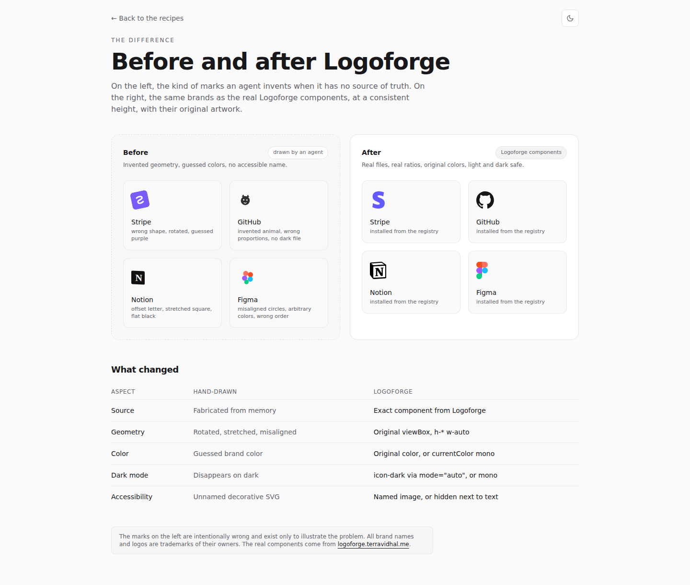
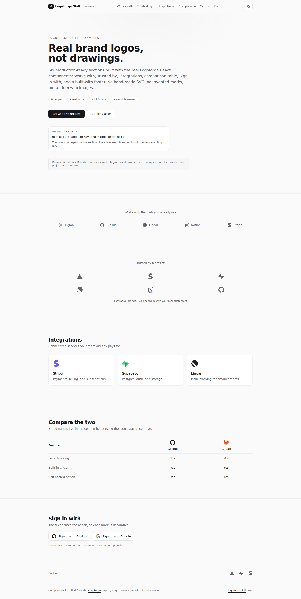
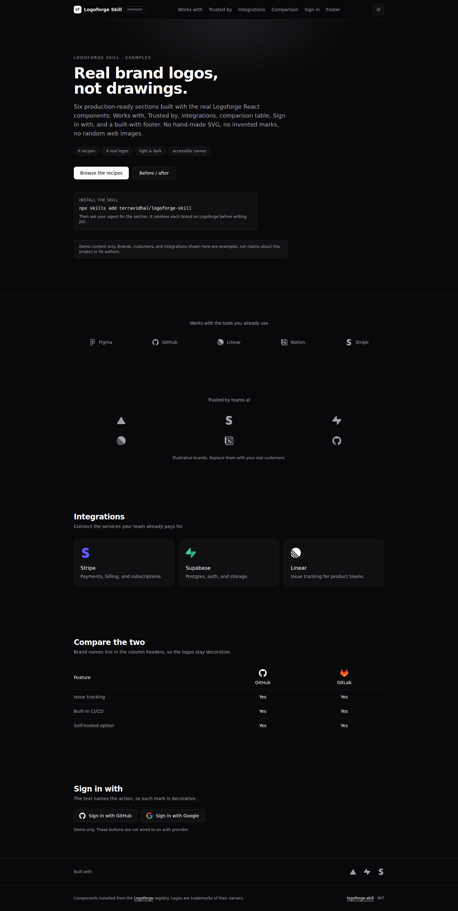
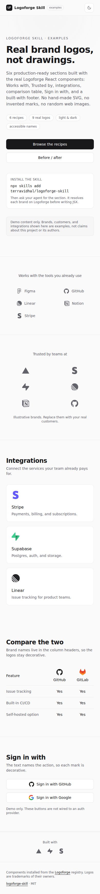
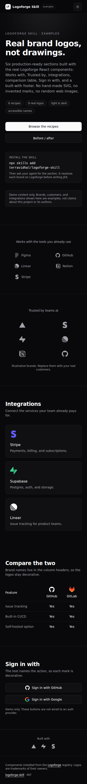

# Rapport — logoforge-skill

Date : 24 novembre 2026
État : prêt à publier (dépôt local complet, tests passés)
Licence : MIT pour le dépôt ; les logos restent des marques de leurs propriétaires.

## 1. Ce qui est prêt

Le dépôt contient un skill Agent Skills complet, en anglais, qui apprend à un agent de
codage à poser les vrais logos de marques via Logoforge, au lieu de les dessiner ou de les
inventer.

- `skills/logoforge/SKILL.md` : déclencheurs, règles non négociables (ne jamais redessiner,
  couleurs d'origine ou mono, proportions, espace, accessibilité, clair/sombre), workflow
  en 7 étapes et checklist finale.
- `skills/logoforge/references/` : cinq fiches pratiques.
  - `finding-logos.md` : résolution d'un slug via MCP, API JSON ou page logo.
  - `installing.md` : installation shadcn, React sans shadcn, SVG pour Vue/Svelte/Astro/HTML,
    mise à jour et logo cloud.
  - `variants.md` : variantes `icon`, `icon-mono`, `icon-dark`, `wordmark`,
    `wordmark-dark`, `official-*`, props, tailles et mode sombre.
  - `sections.md` : six recettes prêtes à adapter (Works with, Trusted by, intégrations,
    pied de page, tableau comparatif, Sign in with).
  - `missing-brand.md` : marche à suivre quand une marque manque, sans logo de substitution.
- `examples/` : projet Next.js minimal avec les six recettes et neuf composants de logos
  réels, non modifiés, servis par le registre Logoforge.
- `assets/readme/` : captures avant/après et desktop/mobile en clair et sombre.
- `assets/demo.gif` : démonstration courte des six recettes.
- `evals/evals.json` : huit prompts de contrôle du comportement du skill.
- `scripts/check-skill.mjs` : vérification locale (frontmatter, liens, JSON, assets).
- `.github/workflows/check.yml` : CI qui lance le lint, installe et construit l'exemple.
- `README.md`, `CONTRIBUTING.md`, `TRADEMARKS.md`, `LICENSE` : documentation et cadre légal.

## 2. Captures

Avant / après :

Desktop, clair et sombre :

| Clair | Sombre |
|---|---|
|  |  |

Mobile, clair et sombre :

| Clair | Sombre |
|---|---|
|  |  |

## 3. Tests effectués

### Vérifications exécutées

| Commande | Résultat |
|---|---|
| `npm run lint` (racine) | OK : frontmatter, 23 fichiers requis, liens relatifs, JSON et assets valides. |
| `npx tsc --noEmit` (dans `examples/`) | OK, aucune erreur TypeScript. |
| `npx tsc --noEmit` (bac à sable Next.js) | OK après installation manuelle du skill et ajout d'une section « Works with ». |

Le bac à sable a reproduit le parcours utilisateur : création d'un projet Next.js vide,
copie de `skills/logoforge` dans `.claude/skills/logoforge` (installation manuelle documentée),
puis ajout d'une section tirée de `references/sections.md` avec des composants de logos
identiques à la sortie du registre. Le typecheck passe.

L'exemple `examples/` a déjà été construit et capturé en production (`.next/BUILD_ID` et
captures du 24/11) ; les images et le GIF ci-dessus en sont issues.

### Adresses et interfaces vérifiées en direct

- Galerie et docs : `https://logoforge.terravidhal.me`, `/docs`, `/docs/api`, `/docs/mcp`,
  `/docs/shadcn`, `/legal`.
- Compte annoncé : 1 031 logos (confirmé sur `/docs` et `/legal`).
- API : `/api/logos.json`, `/api/logos/stripe.json`, `/api/logos/github.json`.
- Registre : `/r/registry.json`, `/r/stripe.json` (source du composant `StripeLogo`),
  `/r/cloud.json` avec paramètres.
- SVG : `/logos/github/icon.svg` et `/logos/github/icon-dark.svg`.
- Formulaire de demande de logo : modèle GitHub `logo-request.md` présent.
- MCP : `https://logoforge.terravidhal.me/mcp`, configurations Claude Code, Cursor et VS Code
  identiques à la documentation officielle.

### Installation et outillage

La commande `npx skills@latest add terravidhal/logoforge-skill --skill logoforge` a été
comparée à la documentation officielle du CLI (`vercel-labs/skills`) :

- options `--skill`, `-a/--agent`, `-g/--global`, `--copy`, `--list` : valides ;
- identifiants d'agents `claude-code`, `codex`, `cursor`, `gemini-cli`, `github-copilot`,
  `opencode` : valides ;
- dossiers globaux manuels (`~/.claude/skills`, `~/.agents/skills`, `~/.cursor/skills`,
  `~/.gemini/skills`, `~/.copilot/skills`, `~/.config/opencode/skills`) : conformes ;
- Node.js 22.20 ou plus récent : conforme.

Cette commande ne peut être réellement exécutée qu'une fois le dépôt GitHub créé. Les
commandes `npm install`, `npm run dev` et `npm run build` n'ont pas été relancées dans cette
session (environnement restreint), mais l'exemple a déjà été construit et capturé, et le
typecheck repasse.

### Corrections faites pendant la relecture

- Les boutons « Sign in with » utilisaient `h-5 w-5`, ce qui fixait largeur et hauteur et
  déformait légèrement les marques GitHub (256 × 250) et Google (256 × 262). Remplacé par
  `h-5 w-auto` dans la recette et dans l'exemple, conformément à la règle du skill.
- Exemple de mode sombre en `` : les chemins des fichiers `icon` et `icon-dark` sont
  maintenant cohérents et incluent la commande de téléchargement des deux fichiers.
- Commande d'installation affichée dans l'exemple alignée sur le README (`--skill logoforge`).
- Formulation des captures dans `examples/README.md` corrigée.

## 4. Ce qu'il reste à Vidhal

1. **Créer le dépôt GitHub public** `terravidhal/logoforge-skill` (licence MIT).
2. **Pousser les commits locaux** (je ne fais ni `git push`, ni `npm publish`, ni création de
   compte).
3. **Vérifier la commande d'installation** depuis un projet neuf :
   `npx skills@latest add terravidhal/logoforge-skill --skill logoforge`.
   Elle ne fonctionnera qu'après l'étape 1.
4. **Publier / référencer le skill** : le CLI lit directement le dépôt GitHub ; une fiche sur
   skills.sh peut ensuite être ajoutée pour la découvrabilité.
5. **Mettre à jour les liens** si le dépôt est renommé : `README.md`, `examples/app/page.tsx`,
   `evals/evals.json` et le formulaire de demande de logo pointent vers
   `github.com/terravidhal/logoforge-skill` ou `github.com/terravidhal/logoforge`.
6. Facultatif : taguer `v0.1.0` et ajouter la capture OG du dépôt.

## 5. Points d'attention

- Les logos sont des marques : voir `TRADEMARKS.md`. Les exemples sont explicitement
  présentés comme des démonstrations, pas comme des clients ou partenaires réels.
- Le skill ne contient aucun logo : la source de vérité reste Logoforge (registre, API, MCP).
- Si une marque manque, le skill renvoie vers le formulaire de demande au lieu d'inventer
  un logo.
- La CI utilise Node 22 et construit `examples/` ; elle vérifiera automatiquement le dépôt
  après publication.
