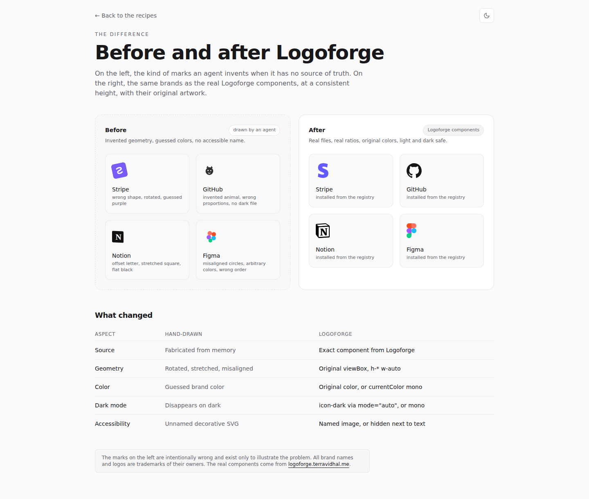
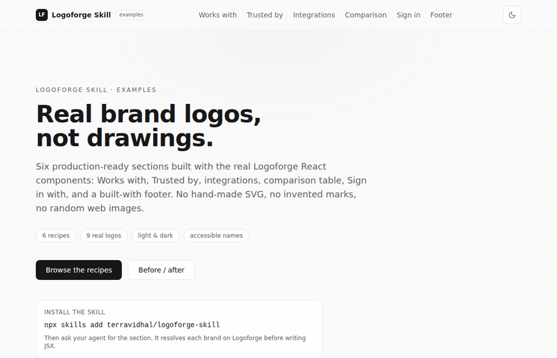
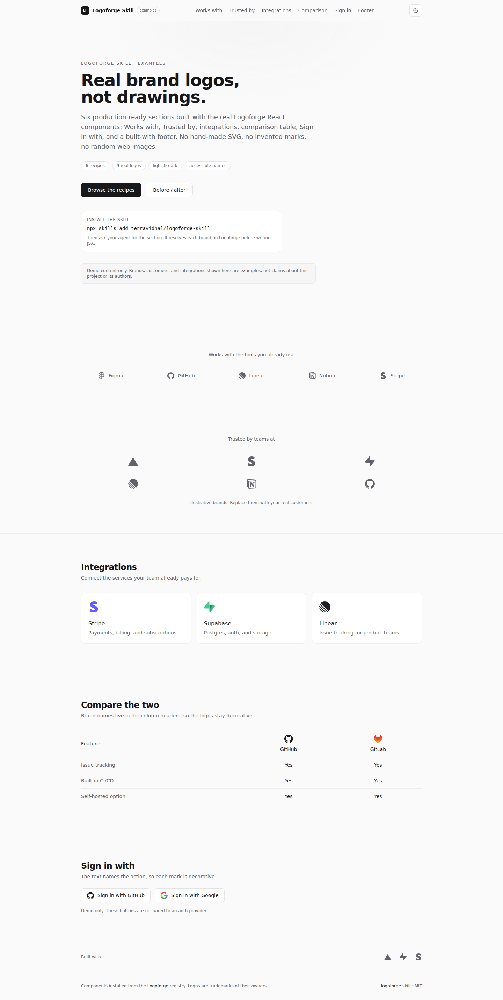
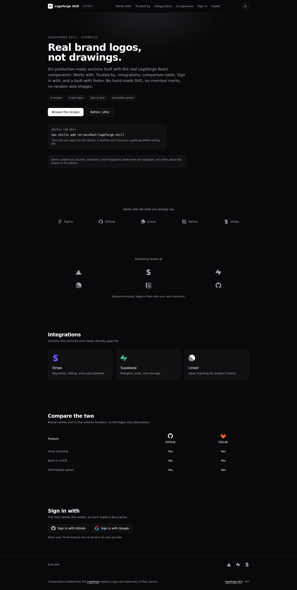
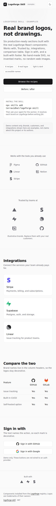
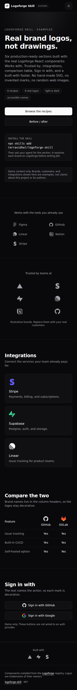

# Logoforge Skill

Real brand logos in your UI, installed by your coding agent.

```bash
npx skills@latest add terravidhal/logoforge-skill --skill logoforge
```

Works with Claude Code, Codex, Cursor, Gemini CLI, GitHub Copilot, OpenCode, and any agent
that reads `SKILL.md`.

Your agent stops drawing, inventing, or guessing logos. It resolves each brand on
[Logoforge](https://logoforge.terravidhal.me), installs the official React component or
SVG, and builds the section you asked for.





A five-second pass over the six recipes, built with the real registry components.

## What it does

- Finds the right Logoforge slug through the MCP server, the JSON API, or the shadcn registry.
- Installs real logos with `npx shadcn@latest add @logoforge/<slug>`, or copies the component/SVG
  when the project does not use shadcn.
- Builds "Works with", "Trusted by", integrations, footer, comparison-table, and
  "Sign in with" sections.
- Enforces brand rules: no redrawing, no distortion, original colors or mono, clear space,
  accessible names, and light/dark support.

## See it running

The [`examples/`](examples/) app builds all six recipes with the real registry components.
Desktop, 1440 px:

| Light | Dark |
|---|---|
|  |  |

Mobile, 390 px:

| Light | Dark |
|---|---|
|  |  |

```bash
cd examples
npm install
npm run dev
```

The six recipes are Works with, Trusted by, integrations, built-with footer, comparison
table, and Sign in with. The logos in `examples/components/logos/` are the unmodified
component files served by `https://logoforge.terravidhal.me/r/<slug>.json`; in a real
project, install them with `npx shadcn@latest add @logoforge/<slug>`. See
[`examples/README.md`](examples/README.md) for the details.

## Install

One command per agent. Skills install into the current project by default; add `-g` to
make the skill available in every project on your machine.

| Agent | One line |
|---|---|
| Claude Code | `npx skills@latest add terravidhal/logoforge-skill --skill logoforge -a claude-code` |
| Codex | `npx skills@latest add terravidhal/logoforge-skill --skill logoforge -a codex` |
| Cursor | `npx skills@latest add terravidhal/logoforge-skill --skill logoforge -a cursor` |
| Gemini CLI | `npx skills@latest add terravidhal/logoforge-skill --skill logoforge -a gemini-cli` |
| GitHub Copilot | `npx skills@latest add terravidhal/logoforge-skill --skill logoforge -a github-copilot` |
| OpenCode | `npx skills@latest add terravidhal/logoforge-skill --skill logoforge -a opencode` |

Add `-g` to install globally, `--copy` to write files instead of symlinks, and `--list` to
preview the skill. The CLI needs Node.js 22.20 or later.

Manual copy, global scope:

| Agent | Folder |
|---|---|
| Claude Code | `~/.claude/skills/logoforge` |
| Codex | `~/.agents/skills/logoforge` |
| Cursor | `~/.cursor/skills/logoforge` |
| Gemini CLI | `~/.gemini/skills/logoforge` |
| GitHub Copilot | `~/.copilot/skills/logoforge` |
| OpenCode | `~/.config/opencode/skills/logoforge` |

```bash
cp -r skills/logoforge ~/.claude/skills/logoforge    # Claude Code
cp -r skills/logoforge ~/.agents/skills/logoforge    # Codex
cp -r skills/logoforge ~/.cursor/skills/logoforge    # Cursor
cp -r skills/logoforge ~/.gemini/skills/logoforge    # Gemini CLI
cp -r skills/logoforge ~/.copilot/skills/logoforge   # GitHub Copilot
cp -r skills/logoforge ~/.config/opencode/skills/logoforge  # OpenCode
```

### MCP server (recommended)

The skill also works with the JSON API. Connecting the read-only MCP server gives the
agent live slugs, variants, install commands, and section code:

```bash
claude mcp add --transport http logoforge https://logoforge.terravidhal.me/mcp
```

Cursor: add `{"mcpServers":{"logoforge":{"url":"https://logoforge.terravidhal.me/mcp"}}}`
to `.cursor/mcp.json`. GitHub Copilot in VS Code: add
`{"servers":{"logoforge":{"type":"http","url":"https://logoforge.terravidhal.me/mcp"}}}`
to `.vscode/mcp.json`. The server needs no key and no account.

## Example prompts

> Add a Trusted by section with the logos of Stripe, Vercel, Supabase, and GitHub.
> Grayscale, and it must work in dark mode.

> Build an integrations page for our payment, auth, and database providers.

> Add a "Sign in with Google" button next to the GitHub one.

> Replace this hand-drawn Notion logo with the real one.

## What it will not do

- Redraw, trace, or approximate a logo.
- Use a screenshot, a random web image, or a file of unknown origin.
- Invent a slug, component name, or variant.
- Add a brand that is not a real customer, partner, or integration.
- Imply an affiliation that does not exist.

## Logoforge

- Site and gallery: https://logoforge.terravidhal.me
- Docs: https://logoforge.terravidhal.me/docs
- API: https://logoforge.terravidhal.me/api/logos.json
- shadcn registry: https://logoforge.terravidhal.me/r/registry.json
- MCP: https://logoforge.terravidhal.me/mcp
- Logo requests: https://github.com/terravidhal/logoforge/issues/new?template=logo-request.md

Logoforge covers 1,031 developer brands. If a brand is missing, the skill points to the
official request form instead of inventing a logo.

## Repository layout

```text
skills/logoforge/     SKILL.md and the five reference files
examples/             minimal Next.js app with the six recipes
assets/readme/        before/after and light/dark screenshots
assets/demo.gif       short demo of the six recipes
evals/evals.json      prompt-level checks for the skill behaviour
scripts/              repository check (npm run lint)
examples/scripts/     demo capture and registry fetcher
```

Maintainer checks:

```bash
npm run lint
npm run demo          # regenerates assets/demo.gif (built examples + ffmpeg)
cd examples && npm ci && npm run build
```

See [CONTRIBUTING.md](CONTRIBUTING.md) for the rules and the files to edit.

## License

MIT for this repository. Logos are trademarks of their owners; see
[TRADEMARKS.md](TRADEMARKS.md).
